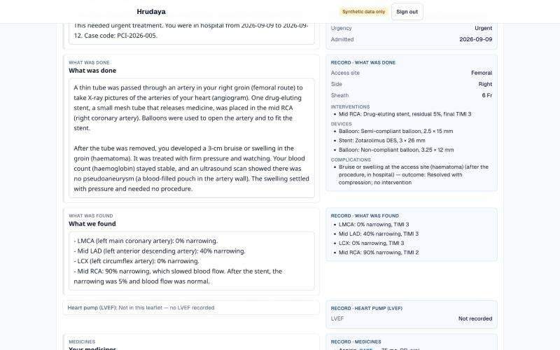
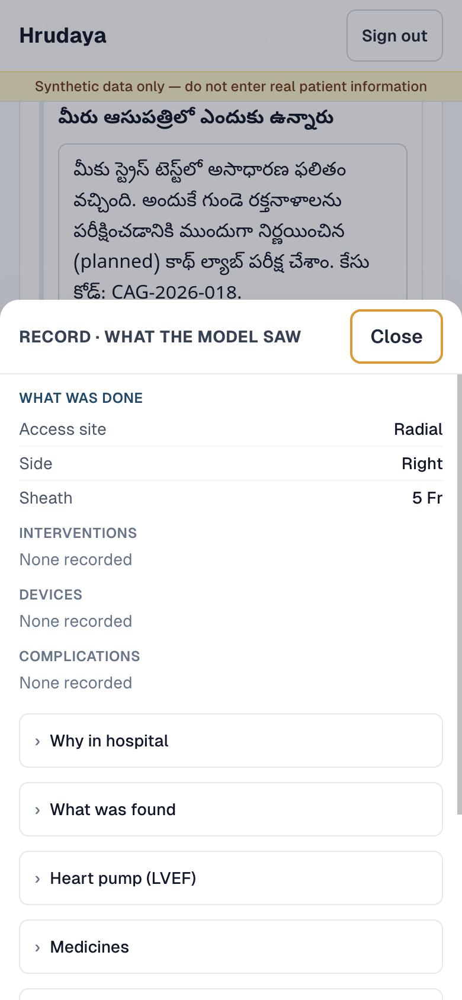

# Hrudaya

Hrudaya is an open-source procedure record for Indian cardiac catheterisation labs. A cath lab
team enters a coronary angiogram or PCI on a phone in six short steps — patient, indication and
access, angiography findings, intervention and devices (with stent lot numbers for traceability),
procedure details and complications, and discharge — and gets a structured record that reads
like a cath report. Every reviewed procedure exports as a validated **FHIR R4 document Bundle**,
ready for India's Ayushman Bharat Digital Mission (ABDM).

**Live demo:** <https://hrudaya.vercel.app> — demo login available on request.

> ⚠️ **Synthetic data only.** This project must never hold real patient information. Every name,
> MRN, operator and device lot number in it is fictional, every patient row is marked
> `is_synthetic` (the database refuses anything else), and no part of it has been assessed for
> clinical use. Do not enter real patient data.
>
> Seeded values that are not in the case files — labs, haemodynamics, radiation dose, coronary
> dominance, procedure times — are deliberately authored synthetic data, marked `ASSUMPTION` in
> `scripts/seed.ts`.

## Scope

- **In scope:** coronary angiography and PCI only. One cath lab. One user role.
- **Not in scope:** other cardiac procedures (EP, structural, peripheral), scheduling, billing,
  imaging, multi-site or multi-role access, and clinical decision support.

## Stack

Next.js 14 (App Router, TypeScript) · Tailwind CSS · Supabase (Postgres, Auth, row-level
security), Mumbai region · Zod · deployed on Vercel. No ORM and no other backend.

## Local setup

Requires **Node 22.18 or later** (the seed script runs TypeScript directly) and a Supabase project.

1. Install dependencies:
   ```bash
   npm install
   ```
2. Copy `.env.example` to `.env.local` and fill in the three values from Supabase →
   Project Settings → API. The service-role key stays on your machine; the app never uses it.
3. Apply the migrations in order (`0001` to `0007`). For a local database, `supabase start`
   (needs Docker) applies them all. For a hosted project, either paste each file from
   `supabase/migrations/` into the Supabase SQL editor, or with the Supabase CLI:
   ```bash
   supabase db query --linked --project-ref <your-project-ref> -f supabase/migrations/0001_init.sql
   ```
4. Create a user: Supabase → Authentication → Users → **Add user** (email and password).
   There is no public sign-up page.
5. Load the 20 synthetic cases (safe to re-run; existing cases are skipped):
   ```bash
   npm run seed
   ```
6. Start the app and sign in at <http://localhost:3000>:
   ```bash
   npm run dev
   ```

After a schema change, regenerate `lib/database.types.ts` with
`SUPABASE_PROJECT_REF=<your-project-ref> npm run db:types`.

## Project layout

| Path | What it holds |
|---|---|
| `docs/week1-spec.md` | The Week 1 spec — source of truth for the data model and form |
| `docs/cases/` | The synthetic reference case and cases 002–020 |
| `docs/backlog.md` | Everything deferred after the Week 1 schema freeze |
| `supabase/migrations/` | Schema, constraints, triggers and RLS |
| `supabase/tests/` | SQL behaviour probe (runs in a transaction that always rolls back) |
| `scripts/seed.ts` | Seeds the 20 synthetic cases |
| `lib/queries/` | Every Supabase query |
| `lib/validation/` | Zod schemas for each form step |
| `lib/fhir/` | FHIR codes (verified), loader, mapper, export logic and their tests |
| `docs/fhir-mapping.md` | Hrudaya → FHIR R4 mapping, codes, validation results |
| `lib/summary/` | AI discharge summary: input builder, prompt, audit, generator, API logic |
| `docs/ai-summary.md` | The guards, prompt, audit rules, eval and cost |
| `scripts/summary-eval.ts` | The six-language eval (`npm run summary:eval`) |
| `lib/summary/sections.ts`, `flag-locations.ts` | Week 5: draft ⇄ sections (lossless), flag placement |
| `components/report/summary-editor.tsx`, `record-panel.tsx`, `compare-sheet.tsx` | Week 5: the reviewer's editor and record panel |
| `docs/reviewer-ux.md` | Week 5: reviewer experience — ideas, rules, screenshots, tests |
| `app/procedures/` | List, detail (cath report) and the 6-step capture form |

## Week 1 definition of done

From [docs/week1-spec.md §7](docs/week1-spec.md):

- [x] Schema migration runs clean on a fresh Supabase project — verified 2026-10-15: 0001–0004 applied in order to a fresh local Supabase (`supabase start`), seed loaded 20/20; schema and all 20 cases identical to production
- [x] Seed loads 20 cases without error
- [ ] New procedure can be entered start to finish on a phone in under 8 minutes — not yet timed
- [ ] Detail page reads like a real cath report — awaiting review
- [x] Deployed on Vercel behind Supabase email login
- [x] README has the scope statement and a "synthetic data only" notice
- [ ] 60-second Friday progress video recorded

## Week 2 — FHIR R4 export

Every reviewed procedure exports as one FHIR R4 **document Bundle** — Composition, Patient,
Encounter, Organization, Location, Practitioner, Condition, Procedure, Device, Observation,
MedicationAdministration and MedicationRequest — from the **Export FHIR** button on the report or
`GET /api/fhir/procedures/<id>` (signed in; drafts are refused). Field-by-field mapping, every
code with how it was verified, and the known validator warnings: [docs/fhir-mapping.md](docs/fhir-mapping.md).

- **Validated:** all 21 reviewed cases (the 20 seeded cases plus PCI-2026-021, entered in the app)
  pass the official HL7 FHIR validator 7.0.1 with **0 errors**:

  | Case | Errors | Warnings |
  |---|---|---|
  | CAG-2026-018 | 0 | 32 |
  | CAG-2026-019 | 0 | 35 |
  | CAG-2026-020 | 0 | 33 |
  | PCI-2026-001 | 0 | 47 |
  | PCI-2026-002 | 0 | 44 |
  | PCI-2026-003 | 0 | 45 |
  | PCI-2026-004 | 0 | 50 |
  | PCI-2026-005 | 0 | 44 |
  | PCI-2026-006 | 0 | 44 |
  | PCI-2026-007 | 0 | 44 |
  | PCI-2026-008 | 0 | 44 |
  | PCI-2026-009 | 0 | 46 |
  | PCI-2026-010 | 0 | 47 |
  | PCI-2026-011 | 0 | 44 |
  | PCI-2026-012 | 0 | 46 |
  | PCI-2026-013 | 0 | 45 |
  | PCI-2026-014 | 0 | 50 |
  | PCI-2026-015 | 0 | 43 |
  | PCI-2026-016 | 0 | 44 |
  | PCI-2026-017 | 0 | 45 |
  | PCI-2026-021 | 0 | 42 |

  The warnings are two kinds, both best-practice and accepted:
  *dom-6 — "a resource should have narrative"* (one per resource: the Composition's sections carry
  narrative, but resources have no `text` of their own yet — backlog), and the *UCUM annotation* in
  eGFR's unit `mL/min/{1.73_m2}` (the conventional unit, chosen in the spec). The first validator run
  found one real error (a dosage with no dose, on PCI-2026-010) which was fixed — so the zero is
  measured, not vacuous.
- **Codes verified:** every SNOMED CT and LOINC code in use is checked against its source; nine codes
  in the original spec were wrong and were corrected (see the spec's "Corrections after build").
  Re-check them any time with `npm run fhir:verify-codes`.
- **Interoperable:** PCI-2026-001's Bundle round-trips through the public HAPI FHIR R4 server
  (Bundle `124023`):

  

  Public HAPI is a shared test server: synthetic data only, and every Bundle is tagged so.

Commands:

```bash
npm test
```

```bash
npm run fhir:verify-codes
```

```bash
npm run fhir:validate
```

```bash
npm run fhir:hapi
```

`fhir:validate` needs Java 17 (`brew install openjdk@17`) and the HL7 validator JAR at
`tools/validator_cli.jar` (see [docs/fhir-mapping.md §5](docs/fhir-mapping.md)). There is no CI
runner in this repo, so run it before each release. `fhir:validate` and `fhir:hapi` read
`.env.local` and use the service-role key — developer machine only.

## Week 2 definition of done

From [docs/week2-fhir-spec.md §8](docs/week2-fhir-spec.md):

- [x] `docs/fhir-mapping.md` complete, every code either verified (with a link) or marked text-only
- [x] All seeded cases export; validator reports 0 errors (21 reviewed cases, 0 errors)
- [x] One Bundle round-trips through public HAPI; screenshot in README
- [ ] Export button works on phone; preview readable — tested at 375 px in a browser, not yet on a phone
- [x] API route refuses unauthenticated and draft requests (tests)
- [x] Unit tests on the mapper: three-state Observations, DAPT extension, not-yet-discharged Encounter, device focalDevice links, stable ids on re-export
- [ ] Pavan can explain the eight resources in two sentences each

## Week 4 — AI discharge summary

A reviewed, discharged procedure can have a **patient discharge summary** drafted with AI
assistance in English, Telugu (తెలుగు), Hindi (हिन्दी), Tamil (தமிழ்), Kannada (ಕನ್ನಡ) or
Malayalam (മലയാളം). The model drafts, the code audits, the clinician signs. Full write-up, with the
prompt, audit rules and eval: [docs/ai-summary.md](docs/ai-summary.md).

- **Four guards:**
  1. The model sees structured fields only: no name, DOB, MRN, lot, expiry or UDI.
  2. A deterministic audit flags every missing or extra drug, every number that is not in the
     record, and every dose that does not follow its drug.
  3. Nothing reaches a patient until a named clinician approves. An error flag blocks approval, and
     an approved row is immutable by trigger.
  4. Drug names and doses are never translated.
- **On the report page:** a Discharge summary card. Choose the language, then Generate draft. The
  red banner reads "AI draft — not reviewed. Do not give to patient." Then audit flags, then Edit
  and approve, then Print. **Print** is `/procedures/<id>/print`: an A4 clinician report (MRN and
  initials only) plus one page per approved summary.
- **Eval (15 Oct 2026):** 19 seeded discharged cases × 6 languages = 114 drafts per run, all
  generated in every run. What each prompt version changed, measured over all 114 drafts:

  | | v1 | v2 | v3 | v4 | v5 | v6 |
  |---|---|---|---|---|---|---|
  | Error flags | 0 | 0 | 0 | **2** (an invented "108", caught) | 0 | 0 |
  | Audit warnings | 37 | 0 | 0 | 0 | 0 | 0 |
  | A section written for an empty part of the record | 37 | 0 | 0 | 0 | 0 | 0 |
  | Frequency in the patient's language with "(OD)" etc. (of 210) | 0 | 0 | 210 | 210 | 210 | 210 |
  | English DAPT explanation (of 17) | 0 | 0 | 17 | 17 | 17 | 17 |
  | English complication described with its outcome (of 2) | 0 | 0 | 0 | 2 | 2 | 2 |
  | Corrected red-flag cases: drafts with both urgency groups and 108 (of 66) | 0 | 0 | 0 | 66 | 66 | 66 |
  | "108" where the record's red flags lack it (of 48) | 0 | 0 | 0 | 2 | 0 | 0 |
  | Longest draft, tokens (limit) | 2,657 (3,000) | 2,557 (3,000) | 2,938 (3,000) | 3,902 (4,000) | 4,006 (6,000) | 3,993 (6,000) |

  The audit blocked two drafts where v4's own prompt wording had caused the model to add "call 108" to a case whose record did not contain it — the layered guards caught a prompt error, not a model error. v5 removed that wording.

  **Prompt v6** (Telugu native-reader feedback): it names the DAPT drugs, translates durations
  with the figure kept, and keeps specific findings specific. The prompt is **frozen at v6**. The v6
  eval is clean (114/114, 0 flags). DAPT drugs are named in 102 of 102 drafts (v5: 1), and 0 of 80
  Indian-language drafts leave durations in English (v5: 58). Details:
  [docs/ai-summary.md](docs/ai-summary.md#eval).

  Cost per summary (v6, the frozen prompt):

  | Language | Avg output tokens | Cost per summary |
  |---|---|---|
  | English | 868 | $0.0136 |
  | Telugu | 1,765 | $0.0226 |
  | Hindi | 1,408 | $0.0191 |
  | Tamil | 1,916 | $0.0241 |
  | Kannada | 3,152 | $0.0365 |
  | Malayalam | 2,289 | $0.0279 |

  Longest Indian-language case: PCI-2026-012 in Kannada, **$0.0452**, about 3.3× English. A whole
  run is about $2–2.75 ($2.04 v1 … $2.73 v6).
- **Read by people:** **Telugu is native-reader checked.** The owner, a native speaker and former
  cath-lab technologist, read five cases: all accurate, with three wording notes and one data
  correction, which became prompt v6 and a red-flag fix. Hindi, Tamil, Kannada and Malayalam are
  **awaiting a native-reader check**: the five-question protocol in
  [docs/ai-summary.md](docs/ai-summary.md#native-reader-check). The audit checks drugs, doses and
  numbers; it cannot judge the prose.

Setup: put `ANTHROPIC_API_KEY` in `.env.local` and in Vercel as a plain environment variable,
**never** `NEXT_PUBLIC_`. Without it, the app runs and Generate is disabled with the reason shown.

```bash
npm run summary:eval
```

This only counts input tokens and prints the estimated cost. Add `-- --confirm` to generate, which
costs real money (about $2 for all 114). Add `-- --reaudit` to re-score the saved drafts in
`tmp/summaries/` without calling the model.

## Week 4 definition of done

From [docs/week4-ai-summary-spec.md §9](docs/week4-ai-summary-spec.md):

- [x] Migration 0008 applied on Supabase before the code deploy. The app runs with and without
  `ANTHROPIC_API_KEY` (the without case was checked locally).
- [x] `buildSummaryInput` unit-tested: no identifiers in any seeded case, nulls omitted, stable hash
- [x] `auditDraft` unit-tested on hand-written English and Telugu drafts; `script_check` for all five scripts
- [ ] Generate works live for PCI-2026-001 in all six languages. Proven by the eval script with the
  same code path, but not yet through the deployed button.
- [x] Approve blocked while an error flag exists, and an approved row is immutable (tested locally
  in the browser and against the trigger)
- [x] Eval: 114 drafts per run, `tmp/summaries/report.md`, zero `drug_missing` / `drug_extra` in every run; prompts v2–v5 zero warnings; v4 had 2 caught `number_unknown` errors; v5 and v6 none
- [ ] Print page renders A4 from Chrome on Mac and phone, with glyphs correct in print preview for
  all five Indian scripts. Not yet checked: needs a real print preview.
- [x] `docs/ai-summary.md` written
- [x] Native-reader check for Telugu (five cases, all accurate, notes acted on in v6)
- [ ] Native-reader check for Hindi, Tamil, Kannada and Malayalam
- [x] v6 eval: 114/114, 0 flags

## Week 5 — Reviewer experience

A clinician reviews an AI draft **section by section, against the record it came from**, on a
phone, without touching Markdown. Generation, the audit rules, approval and the database are
unchanged. Write-up: [docs/reviewer-ux.md](docs/reviewer-ux.md).

- **Structured editor.** One block per section, with headings read-only. The medicines table is
  rendered **from the record** and can't be edited here. A reviewed procedure can't be edited yet
  either; amendments are planned (first on the backlog). Only the wording is editable. View Markdown shows exactly what will be saved. A draft whose sections
  don't match the record falls back to the old single textarea with a notice.
- **Compare with record.** The record as the model saw it, grouped by section: a second column on
  a laptop (each group sticks beside its section), a bottom sheet on a phone. Missing values read
  `Not recorded` / `Not performed` / `None recorded`, never blank.
- **Flags beside sections.** Each audit flag sits under the section that caused it, outlined red
  or amber. The audit re-runs 400 ms after typing, and Approve waits for it.

| Laptop | Phone |
|---|---|
|  |  |

- **Round trip** (`npm run summary:roundtrip`): parse → serialise is byte-identical for **833 of
  833** texts, with 0 mismatches:
  - 798 saved eval drafts (v1–v6);
  - 16 texts from 13 production rows;
  - 19 texts from 17 local rows.
- **Flag-placement tests** (`lib/summary/flag-locations.test.ts`, 15):
  - a dose error goes to medicines;
  - an invented findings number goes to "found";
  - `section_extra` stays global (from a real extra heading, and on a structured draft);
  - `section_missing`, `too_long` and `script_check` are global;
  - a missing drug goes to medicines;
  - an extra drug goes where it is written (in prose, or in the table);
  - a forbidden phrase goes to its section;
  - a token in two sections goes to the first;
  - numbers match whole;
  - a fallback draft puts everything in global;
  - `medicine_row_unmatched` goes to medicines;
  - every flag is placed exactly once;
  - across all 114 v6 drafts in six languages, an invented number planted in "What we found"
    lands on "found".
- **Phone checks (390 px)**, each language on its longest draft: no horizontal scroll, textareas
  at 16 px with nothing clipped, the Compare sheet opens and closes by tap and by keyboard, and
  focus is trapped. Not yet tried on a real phone.

```bash
npm run summary:roundtrip
```

## Week 5 definition of done

From [docs/week5-reviewer-spec.md §8](docs/week5-reviewer-spec.md):

- [x] Round trip byte-identical for every saved draft and every database row (833/833); the script
  and the unit test fail on a mismatch
- [x] Fallback path: wrong heading count gives the single textarea with a notice, and can still be
  approved (tested in the browser)
- [x] `locateFlags` unit-tested (15 tests, including the three in the spec)
- [x] Phone width: all six languages on the longest draft, no horizontal scroll, textareas ≥ 16 px,
  sheet works with keyboard and touch (emulated; a real phone is still on the list)
- [x] Record panel: CAG-2026-018 shows `Not performed` (LVEF) and `None recorded`
  (complications); PCI-2026-005 shows the complication with its outcome
- [x] Approve path unchanged: 422 on an error, immutable after approval (existing tests pass,
  none weakened)
- [x] `docs/reviewer-ux.md` and this section
- [ ] Owner read-through: Pavan approves one Telugu draft in the new editor on his phone without
  opening View Markdown

## Roadmap

- **Week 1 — built and deployed:** schema with RLS and audit columns, 6-step capture form, list and detail pages, 20 synthetic cases. Remaining checks above.
- **Week 2 — FHIR R4 export, built:** document Bundle per reviewed procedure, HL7 validator 0 errors, HAPI round-trip. Remaining checks above.
- **Week 3 — ABDM:** ABHA number and address, Health Information Provider (HIP) integration.
- **Week 4 — AI discharge summary, built:** six languages, audit, clinician approval, print report. Remaining checks above.
- **Week 5 — Reviewer experience, built:** structured editor, compare with record, flags beside sections. Remaining checks above.
- **Next:** ABDM (Week 3, waiting on sandbox credentials), form navigation for the capture steps, tighter row-level security.

## Licence

See [LICENSE](LICENSE).
