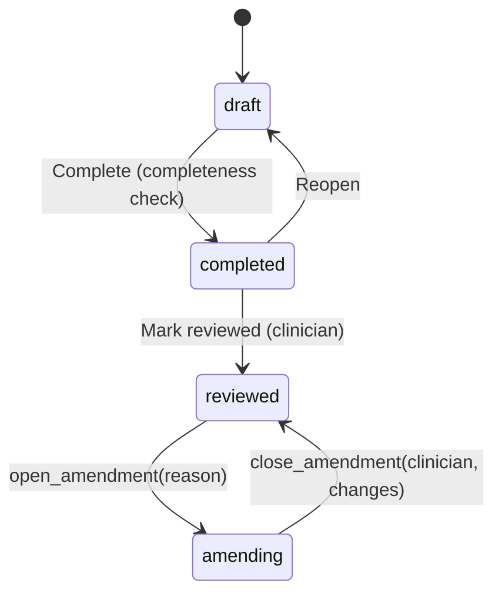
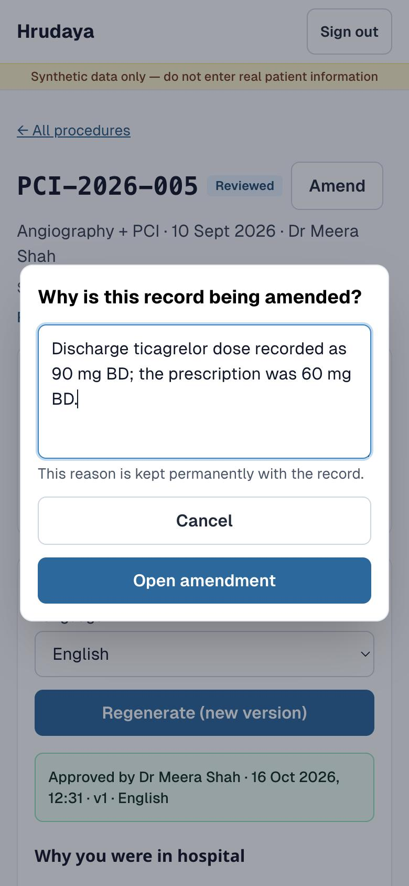
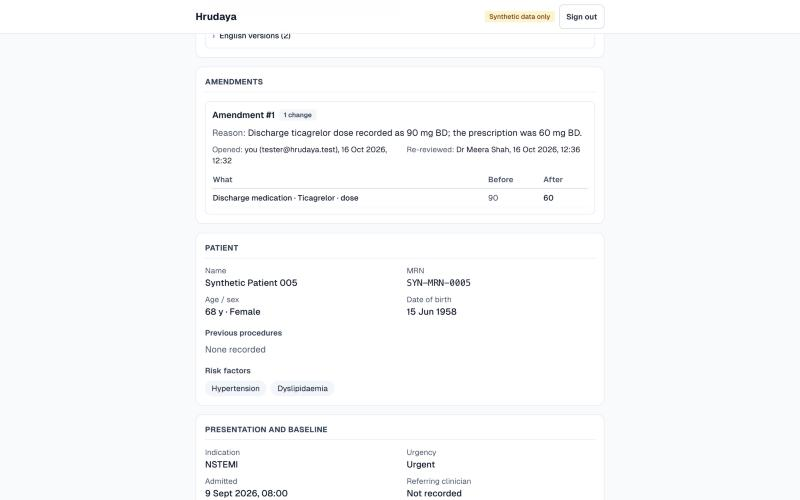

# Amending a reviewed procedure

Week 6. Spec: [week6-amendments-spec.md](week6-amendments-spec.md) (see its Corrections for where
the build differs).

## Why

A reviewed record is signed. Before Week 6 it was also frozen: the two synthetic data corrections
on 15 Oct 2026 had to switch the guards off in hand-written SQL. A hospital can't work that way,
and "how do you correct a signed record?" is the first thing a hospital IT reviewer asks.

The answer is the one paper notes have always used: strike through, write the correction, sign
and date it, and keep the original readable. In Hrudaya that is four rules:

1. **Reason first.** A reviewed record can't be unlocked without a written reason (10 characters
   or more). The reason is stored for good.
2. **The original is kept.** At unlock the database stores a full snapshot of the record. At
   re-review it stores the field-by-field difference, before and after.
3. **Second signature.** An amended record isn't valid until a clinician reviews it again. The
   amendment records who opened it and who signed it off.
4. **Everything downstream knows.**
   - The FHIR Composition becomes `amended`, with a Provenance for each amendment.
   - Discharge summaries approved before the change are marked superseded and are not printed.
   - The report shows an Amendments card.

> We never edit a signed record. We open an amendment with a reason, keep the snapshot, and the
> clinician signs the diff.

## States



```
draft → completed → reviewed ⇄ amending
```

- `amending` reads **"Amendment in progress"** (amber) everywhere. It never shows as "Draft".
- A reviewed record that has been amended reads **"Reviewed · amended ×N"**. N counts closed
  amendments with at least one change.
- The only way into or out of `amending` is through the two functions. A direct
  `update procedures set status = …` is refused, even with the service role.

## What the user does

1. **Report → Amend.** A dialog asks "Why is this record being amended?" and needs at least 10
   characters ("This reason is kept permanently with the record."). Choose **Open amendment**.
2. The report now shows an amber banner:
   - the text: "Amendment #N opened by … on …: reason";
   - **Edit record**, which opens the usual capture steps;
   - **Review changes and re-review**.

   While the amendment is open:
   - FHIR export and new discharge summaries are paused, each with the reason given;
   - the print page says the report is available after re-review.
3. **Capture steps** work as they do for a draft, except:
   - the header carries the amendment banner;
   - the patient step is read-only, with a lock note;
   - case code and procedure date are locked;
   - the last step's button is **Save and review changes**.
4. **Changes you are signing.** This page lists every change (what, before, after). Choose the
   re-reviewing clinician, then **Complete and re-review**. If nothing changed, the button reads
   **Close amendment (no changes)**.
5. Back on the report:
   - the badge reads "Reviewed · amended ×N";
   - the **Amendments** card lists each amendment: number, reason, opened by and when,
     re-reviewed by and when, and its changes;
   - an approved discharge summary written from the old record shows **"Superseded — record
     amended on … (amendment #N)"**, with **Regenerate (new version)**;
   - the versions list marks it "Superseded".

| Amend dialog (phone, 390 px) | Amendments card (laptop, 1440 px) |
|---|---|
|  |  |

**Print page.** Superseded summaries are not printed. The page lists each one in a line such as
"Discharge summary (English, version 1) superseded by amendment #1 on 16 Oct 2026, 12:36 — not
printed." After the procedure report, an Amendments table gives the number, date, reason,
change count and re-reviewing clinician.

**Summary editor.** The medicines hint now reads: "Medicines come from the record. To change a
dose, amend the procedure."

## Database (migrations 0009 and 0010)

`0009_amending_status.sql` adds the enum value on its own: Postgres can't use a new enum value in
the transaction that adds it. `0010_amendments.sql` holds everything else.

### `procedure_amendments`

The columns follow spec §2, plus a check that `changes` is a JSON array.
- **One open amendment per procedure**, enforced by a partial unique index
  (`procedure_amendments_one_open`).
- **RLS:** signed-in users can read rows. Nobody can insert, update or delete them directly; the
  table changes only through the functions.
- **Closed amendments are immutable**, enforced by a trigger that holds even for the service role.
  An open one changes only by being closed.

### `open_amendment(p_procedure_id uuid, p_reason text) returns uuid`

`security definer`, `search_path ''`, executable by `authenticated` only.

| Refuses when | Error hint | API |
|---|---|---|
| no signed-in user | `amendment_needs_user` | 401 |
| reason under 10 characters after trimming | `amendment_reason_too_short` | 422 |
| no such procedure | `procedure_not_found` (P0002) | 404 |
| status is not `reviewed` (draft, completed, or already amending) | `amend_needs_reviewed` | 409 |

All of this happens in one transaction:
1. It inserts amendment *n + 1* with the trimmed reason, `opened_by = auth.uid()`, the snapshot
   from `procedure_snapshot`, and the previous `reviewed_at` and reviewing clinician.
2. It sets `status = 'amending'` and clears the review fields. The transaction-local setting
   `hrudaya.amending` is switched on for this step only.
3. It logs `amendment_opened` with `{amendment_no, reason}`.

### `close_amendment(p_procedure_id uuid, p_reviewing_clinician_id uuid, p_changes jsonb) returns void`

| Refuses when | Error hint | API |
|---|---|---|
| no signed-in user | `amendment_needs_user` | 401 |
| `p_changes` is not an array | `amendment_changes_invalid` | 422 |
| no clinician | `amendment_needs_clinician` | 422 |
| no such procedure | `procedure_not_found` (P0002) | 404 |
| not amending, or no open amendment | `amendment_not_open` | 409 |
| **the list lies**: empty while the record differs from the snapshot, or non-empty while it is identical | `amendment_diff_mismatch` | 409 |
| the record fails the completeness check (e.g. a PCI with no intervention) | `no_vessel_findings` / `pci_without_intervention` / `diagnostic_with_intervention` | 422 |

If none of those apply:
1. It sets `status = 'reviewed'` and the new clinician. The trigger stamps
   `reviewed_by = auth.uid()` and `reviewed_at = now()`: the second signature.
2. It closes the amendment with `closed_by`, `closed_at`, the clinician and `changes`.
3. It logs `amendment_closed` with `{amendment_no, change_count, reviewing_clinician_id}`.

The generic `reviewed` and `reopened` events are not logged for these moves.

### `procedure_snapshot(p uuid) returns jsonb`

The canonical record, built in SQL.
- **Left out:** ids, foreign keys, audit columns, review fields, and the fields an amendment can't
  change (case code, procedure date, patient).
- **Interventions** carry their lesion as `{vessel, segment}`, with their devices nested.
- **Child rows** are sorted by explicit natural-key tuples.

`lib/amendments/snapshot.ts` builds the same thing from the app's loader. A seeded test checks
the two match for every case.

### Guards

- **`guard_procedure_review`:**
  - `reviewed ⇄ amending` only while `hrudaya.amending` is on;
  - while amending: case code, procedure date and patient are locked, and status changes only
    by closing;
  - a reviewed record stays read-only.
- **`guard_patient_during_amendment`** (new) refuses changes to the patient row and its risk
  factors while any of the patient's procedures is amending.
- **Seven delete policies** now use `procedure_is_editable()` (draft or amending) instead of
  `procedure_is_draft()`.
- **`check_procedure_completion`** also runs on `amending → reviewed`.
- **Approved discharge summaries stay immutable.** The amendment work doesn't touch that trigger;
  a test confirms it.

## App

- **`lib/amendments/snapshot.ts`:** `snapshotProcedure`, `canonicalJson` (keys sorted, so equal
  records serialise byte-identically).
- **`lib/amendments/diff.ts`:** `diffSnapshots(before, after) → Change[]`, where
  `Change = {path, label, before, after, kind}`.
  - Rows are matched by natural key, never by position, so re-saving a step (new ids, new order)
    isn't a change.
  - Advice and red flags are compared item by item; "red flags reordered" is one change, because
    order carries the urgency groups.
  - Labels come from the report's label tables, e.g. "Discharge medication · Ticagrelor · dose".
- **`lib/amendments/api.ts`:** `openAmendment` and `closeAmendment`, without Next, so they can be
  tested with fakes.
- **Routes:** `POST /api/procedures/[id]/amendments` and `…/amendments/close`. Both use the
  signed-in user's Supabase client; RLS applies and there is no service role.
- **Close never stores the client's list.** It recomputes the diff from the stored snapshot and
  the current record, and signs only if that equals what the clinician was shown. Otherwise it
  answers 409 with the fresh list, and the page swaps it in to be read again.
- **Summaries.** `lib/summary/blocker.ts` pauses generation while amending. A summary is
  superseded when it was approved and its `input_hash` differs from the current record's.

## Tests and results (16 Oct 2026)

**SQL behaviour: 55 checks, all pass.**
- File: `supabase/tests/0009_behaviour.sql`. It rolls back and also runs on a database that
  already holds amendments.
- Coverage: spec §6 items 1–4, i.e. open, editing while amending, identity locks, direct status
  changes refused, close and its refusals (including both lying-diff cases), the second
  signature, events, approved-summary immutability, and the service role and anon.
- Each of four deliberate breaks to the migration made its tests fail.

**Snapshot parity** (`npm run test:seeded`): TypeScript snapshot = SQL snapshot for **20/20**
local and **21/21** production cases.
- Controls: the sort really reorders rows, and tampering is detected.
- Not exercised: intervention ordering. No seeded case has two interventions on the same lesion
  and type.

**Diff (`lib/amendments/diff.test.ts`, 11 tests):**
1. no change → `[]`
2. re-saving a step (new ids, timestamps and order for child rows) is not a change
3. dose change on a discharge medication
4. device lot number added (was empty)
5. complication outcome edited
6. red-flag item removed
7. red flags reordered (same items) is one change
8. arrays match by natural key: a vessel finding added, another's stenosis changed
9. a device removed, a procedure field changed, a medication added
10. discharge added where there was none
11. fields an amendment can't change (case code, date, patient, review fields) are never in the
    diff

Matching rows by position instead makes 4 of them fail.

**API (`lib/amendments/api.test.ts`, 11 tests):** 201/200 paths; 401, 404 and 422 before any
database call; database refusals mapped to 401/404/409/422; a list with its keys in another order
is still accepted; 409 with the fresh list when the record changed; an unchanged record signs `[]`.

**FHIR:** 4 mapper tests plus the export's 409 while amending; see
[fhir-mapping.md](fhir-mapping.md).

**End to end, local data:** PCI-2026-005 amended in the browser at 390 px.
1. English summary v1 approved.
2. Amend with reason "Discharge ticagrelor dose recorded as 90 mg BD; the prescription was 60 mg
   BD."
3. Edit Ticagrelor dose 90 → 60, then Save and review changes. Exactly one change was listed:
   "Discharge medication · Ticagrelor · dose 90 → 60".
4. Complete and re-review (Dr Meera Shah). The report showed "Reviewed · amended ×1", the
   Amendments card, and v1 "Superseded — record amended on 16 Oct 2026, 12:36 (amendment #1)".
5. Regenerate (the one real model call this week): v2 has "Ticagrelor (DAPT) | 60 mg | twice a
   day", with no audit flags. v2 approved.
6. Print listed v1 as superseded and not printed, printed v2, and showed the amendments table.
7. In the database: one closed amendment with one change, `amendment_opened` and
   `amendment_closed` events, and no generic `reviewed` event.

**Phone (390 px, emulated):** the reason dialog, amber banner, Changes-you-are-signing table and
Amendments card all fit with no horizontal scroll.

**Build:** `next build` passes and `npm test` passes 146/146.

## Not built (backlog)

- Roles (anyone signed in can open and close an amendment).
- Amending patient identity, case code or procedure date.
- Cancelling an open amendment with rollback (close it with no changes instead).
- Display names for users (opened by shows "you (email)" or "another user").
- Patient details can still change through a new draft for the same patient, which alters what
  signed records display.

All of these are in [backlog.md](backlog.md).
