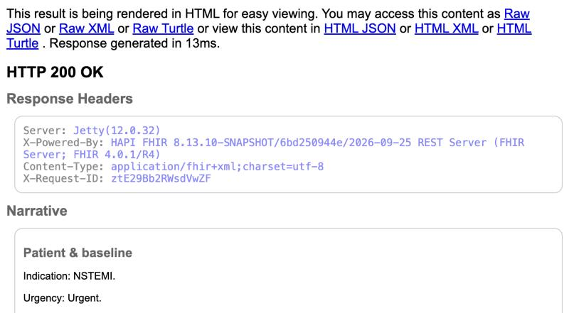

# Hrudaya → FHIR R4 mapping

How one Hrudaya procedure becomes one FHIR R4 **document Bundle**, field by field, with every code
used and how it was verified. Source of truth for the rules: `docs/week2-fhir-spec.md`; data model:
`docs/week1-spec.md` §3. Code: `lib/fhir/codes.ts` (codes), `lib/fhir/mapper.ts` (mapping),
`lib/fhir/load.ts` (rows), `lib/fhir/export.ts` + `app/api/fhir/procedures/[id]/route.ts` (endpoint).

> Synthetic data only. Every Bundle and Patient carries `meta.tag`
> `https://hrudaya.dev/tags#synthetic` — "Synthetic data — not a real patient".

---

## 1. Bundle shape

```
Bundle  type=document · identifier https://hrudaya.dev/case-code|<case_code> · timestamp=export time · meta.tag synthetic
 ├─ Composition (first entry)   — the cover page; sections point at everything below
 ├─ Patient                     ├─ Encounter
 ├─ Organization (facility)     ├─ Location (cath lab)
 ├─ Practitioner (operator)     ├─ Practitioner (reviewer, when a different person)
 ├─ Condition (indication)      ├─ Condition × risk factors
 ├─ Procedure (the cath / PCI)  ├─ Device × every devices_used row
 ├─ Observation × n             ├─ MedicationAdministration × procedure_medications
 ├─ MedicationRequest × discharge_medications (none until discharged)
 └─ Provenance × signed amendments (Week 6; only on an amended record)
```

- **Ids** are stable: the database row id, or for resources with no row of their own (Encounter,
  Composition, Location, the indication Condition, procedure-level Observations) a SHA-1 based UUID
  of *(row id, purpose)*. Re-exporting gives identical content apart from `Bundle.timestamp`.
- `fullUrl` = `urn:uuid:<id>`; every reference is a `urn:uuid:` inside the Bundle.
- **Composition sections**, in report order: Patient & baseline · Access · Angiography ·
  Intervention & devices · Procedure medications · Procedure details · Complications ·
  Immediate outcome · Discharge, then **Amendments** when the record has a closed amendment
  (Week 6). Each has a short generated narrative; a section with nothing to
  point at carries `emptyReason` (`nilknown`, or `notstarted` for a patient not yet discharged).

## 2. How codes were verified

Only a **verified** code is ever emitted as a `coding`. Anything unverified or rejected is exported
as `text` only. No code is invented. `npm run fhir:verify-codes` re-checks every verified SNOMED and
LOINC entry against tx.fhir.org (exists, active, our display is one of its designations).

| System | Verified against | Notes |
|---|---|---|
| LOINC | loinc.org detail page for the code | Display = LOINC long common name as served by tx.fhir.org |
| SNOMED CT | `tx.fhir.org/r4/CodeSystem/$lookup` (SNOMED CT International 2025-02-01) | Owner-approved source: browser.ihtsdotools.org would not load in this environment. The display must match the intended meaning. |
| HL7 code systems | FHIR R4 specification pages | v3-ActCode, condition-clinical, condition-category, observation-category, data-absent-reason, list-empty-reason, composition-attestation-mode |
| UCUM | FHIR R4 / UCUM | validated by the HL7 validator on every run |

### 2.1 Corrections to the spec's codes

The spec's suggestions were checked before use. These failed and were corrected (owner-approved) or
made text-only. `docs/week2-fhir-spec.md` has been corrected to match.

| Use | Spec code | What the code actually is | Action |
|---|---|---|---|
| STEMI | SNOMED 401314000 | Acute **non**-ST segment elevation myocardial infarction | **Swapped** — STEMI is 401303003 |
| NSTEMI | SNOMED 401303003 | Acute ST segment elevation myocardial infarction | **Swapped** — NSTEMI is 401314000 |
| Positive / abnormal stress test | SNOMED 429559004 | Typical angina | Text only |
| Prior PCI (as a Condition) | SNOMED 415070008 | Percutaneous coronary intervention — the procedure | Text only for the Condition (still the Procedure code) |
| LMCA | SNOMED 73208009 | Unknown code | Text only |
| LCX | SNOMED 57396005 | Unknown code | Text only (so OM1/OM2 too) |
| Coronary artery dissection | SNOMED 234020005 | Vasculitis secondary to drug | Text only |
| Creatinine | LOINC 2160-0 | Creatinine [Mass/volume] — Hrudaya stores µmol/L | Replaced by 14682-9 (molar) |
| Activated clotting time | LOINC 3184-5 | Invalid check digit | Replaced by 3184-9 |
| Composition type | LOINC 34896-3 | Invalid check digit | Replaced by 34896-1 |

### 2.2 Codes in use

| Concept | System | Code | Display | Source |
|---|---|---|---|---|
| STEMI | SNOMED | 401303003 | Acute ST segment elevation myocardial infarction | [$lookup](https://tx.fhir.org/r4/CodeSystem/$lookup?system=http://snomed.info/sct&code=401303003) |
| NSTEMI | SNOMED | 401314000 | Acute non-ST segment elevation myocardial infarction | [$lookup](https://tx.fhir.org/r4/CodeSystem/$lookup?system=http://snomed.info/sct&code=401314000) |
| Unstable angina | SNOMED | 4557003 | Preinfarction syndrome (synonym: *Unstable angina*) | [$lookup](https://tx.fhir.org/r4/CodeSystem/$lookup?system=http://snomed.info/sct&code=4557003) |
| Stable angina | SNOMED | 233819005 | Stable angina | [$lookup](https://tx.fhir.org/r4/CodeSystem/$lookup?system=http://snomed.info/sct&code=233819005) |
| Hypertension | SNOMED | 38341003 | Hypertensive disorder | [$lookup](https://tx.fhir.org/r4/CodeSystem/$lookup?system=http://snomed.info/sct&code=38341003) |
| Type 2 diabetes | SNOMED | 44054006 | Type 2 diabetes mellitus | [$lookup](https://tx.fhir.org/r4/CodeSystem/$lookup?system=http://snomed.info/sct&code=44054006) |
| Type 1 diabetes | SNOMED | 46635009 | Type 1 diabetes mellitus | [$lookup](https://tx.fhir.org/r4/CodeSystem/$lookup?system=http://snomed.info/sct&code=46635009) |
| Dyslipidaemia | SNOMED | 370992007 | Dyslipidemia | [$lookup](https://tx.fhir.org/r4/CodeSystem/$lookup?system=http://snomed.info/sct&code=370992007) |
| Current smoker | SNOMED | 77176002 | Smoker | [$lookup](https://tx.fhir.org/r4/CodeSystem/$lookup?system=http://snomed.info/sct&code=77176002) |
| Ex-smoker | SNOMED | 8517006 | Ex-smoker | [$lookup](https://tx.fhir.org/r4/CodeSystem/$lookup?system=http://snomed.info/sct&code=8517006) |
| Family history | SNOMED | 266894000 | FH: Cardiovascular disease (broader than CHD) | [$lookup](https://tx.fhir.org/r4/CodeSystem/$lookup?system=http://snomed.info/sct&code=266894000) |
| CKD | SNOMED | 709044004 | Chronic kidney disease | [$lookup](https://tx.fhir.org/r4/CodeSystem/$lookup?system=http://snomed.info/sct&code=709044004) |
| Obesity | SNOMED | 414916001 | Obesity | [$lookup](https://tx.fhir.org/r4/CodeSystem/$lookup?system=http://snomed.info/sct&code=414916001) |
| Prior CABG | SNOMED | 399261000 | History of coronary artery bypass grafting | [$lookup](https://tx.fhir.org/r4/CodeSystem/$lookup?system=http://snomed.info/sct&code=399261000) |
| Prior MI | SNOMED | 399211009 | History of myocardial infarction | [$lookup](https://tx.fhir.org/r4/CodeSystem/$lookup?system=http://snomed.info/sct&code=399211009) |
| Coronary angiography | SNOMED | 33367005 | Angiography of coronary artery | [$lookup](https://tx.fhir.org/r4/CodeSystem/$lookup?system=http://snomed.info/sct&code=33367005) |
| PCI | SNOMED | 415070008 | Percutaneous coronary intervention | [$lookup](https://tx.fhir.org/r4/CodeSystem/$lookup?system=http://snomed.info/sct&code=415070008) |
| LAD (and D1/D2 as its branches) | SNOMED | 59438005 | Structure of left anterior descending artery | [$lookup](https://tx.fhir.org/r4/CodeSystem/$lookup?system=http://snomed.info/sct&code=59438005) |
| RCA | SNOMED | 13647002 | Right coronary artery structure | [$lookup](https://tx.fhir.org/r4/CodeSystem/$lookup?system=http://snomed.info/sct&code=13647002) |
| Access-site haematoma | SNOMED | 385494008 | Hematoma (site in text) | [$lookup](https://tx.fhir.org/r4/CodeSystem/$lookup?system=http://snomed.info/sct&code=385494008) |
| BP panel | LOINC | 85354-9 | Blood pressure panel with all children optional | [loinc.org](https://loinc.org/85354-9/) |
| Systolic BP | LOINC | 8480-6 | Systolic blood pressure | [loinc.org](https://loinc.org/8480-6/) |
| Diastolic BP | LOINC | 8462-4 | Diastolic blood pressure | [loinc.org](https://loinc.org/8462-4/) |
| Heart rate | LOINC | 8867-4 | Heart rate | [loinc.org](https://loinc.org/8867-4/) |
| LVEF | LOINC | 10230-1 | Left ventricular Ejection fraction | [loinc.org](https://loinc.org/10230-1/) |
| Creatinine | LOINC | 14682-9 | Creatinine [Moles/volume] in Serum or Plasma | [loinc.org](https://loinc.org/14682-9/) |
| eGFR | LOINC | 62238-1 | GFR … by Creatinine-based formula (CKD-EPI)/1.73 sq M — *asserts CKD-EPI; Hrudaya does not record the formula* | [loinc.org](https://loinc.org/62238-1/) |
| Haemoglobin | LOINC | 718-7 | Hemoglobin [Mass/volume] in Blood | [loinc.org](https://loinc.org/718-7/) |
| Platelets | LOINC | 777-3 | Platelets [#/volume] in Blood by Automated count | [loinc.org](https://loinc.org/777-3/) |
| ACT | LOINC | 3184-9 | Activated clotting time (ACT) of Blood by Coagulation assay | [loinc.org](https://loinc.org/3184-9/) |
| Document type | LOINC | 34896-1 | Cardiology Interventional procedure note | [loinc.org](https://loinc.org/34896-1/) |
| Amendment (Provenance.activity) | v3-DataOperation | UPDATE | revise | [$lookup](https://tx.fhir.org/r4/CodeSystem/$lookup?system=http://terminology.hl7.org/CodeSystem/v3-DataOperation&code=UPDATE) (checked 16 Oct 2026; the display is "revise", not "update") |

**Text only** (no verified code): positive stress test, pre-op assessment, cardiomyopathy work-up,
other indication; prior PCI; LMCA, LCX, OM1, OM2, ramus, PDA, PLV, graft, other vessel (PDA/PLV's
parent depends on dominance, so no parent code is guessed); every complication except access-site
haematoma; all drug names (coding them is backlog); aortic pressure, LVEDP, stenosis, TIMI,
residual, contrast, fluoroscopy, air kerma and DAP Observations (spec: text by design).

## 3. Field-by-field mapping

### Patient ← `patients`
| FHIR | Hrudaya |
|---|---|
| `identifier` | `https://hrudaya.dev/mrn` \| `mrn` (Week 3 adds ABHA) |
| `name.text` · `gender` · `birthDate` | `full_name` · `sex` · `date_of_birth` |
| `meta.tag` | synthetic, when `is_synthetic` |

### Encounter ← `procedures`, `discharges`, `facilities`
| FHIR | Hrudaya |
|---|---|
| `status` | `finished` when a discharge row exists, else `in-progress` |
| `class` | v3-ActCode `AMB` for an *elective* case admitted and discharged the same IST day; `IMP` otherwise |
| `period.start` / `.end` | `admitted_at` / `discharges.discharged_at` (end absent until discharge) |
| `reasonReference` | the indication Condition |
| `location` / `serviceProvider` | Location (cath lab) / Organization (facility) |

### Condition ← `procedures.indication`, `patient_risk_factors`
| FHIR | Hrudaya |
|---|---|
| `code` | §2.2 code where verified, always with text (risk-factor detail appended, e.g. "Hypertension — 10 years") |
| `category` | indication: `encounter-diagnosis`; risk factor: `problem-list-item` (both with text) |
| `clinicalStatus` | `active` · `subject` → Patient · indication `encounter` → Encounter |

### Procedure ← `procedures`, `interventions`, `complications`, `operators`
| FHIR | Hrudaya |
|---|---|
| `code` | diagnostic-only: 33367005; PCI: 415070008 + 33367005 |
| `status` | `completed` (`in-progress` for a draft, which is never exported) |
| `performedPeriod` | `started_at` → `ended_at` |
| `performer.actor` · `location` · `encounter` | primary operator · Location · Encounter |
| `bodySite[]` | one per treated vessel; verified code + "Proximal LAD"-style text |
| `focalDevice[]` | each stent (`action.text` "implanted") and drug-coated balloon ("applied") → Device |
| `complication[]` | each complications row: code where verified, text "Access site haematoma (minor) — outcome" |
| `note` | `outcome_summary` (final impression) |
| `extension` | `…/urgency` valueCode; `…/access-site` valueCodeableConcept (text); `…/coronary-dominance` valueCode |

### Device ← `devices_used` (one per row)
| FHIR | Hrudaya |
|---|---|
| `deviceName` | `product_name`, type `user-friendly-name` |
| `type.text` | "<product> — <phase> <category>", e.g. "Xience Skypoint DES — Deployed stent" |
| `lotNumber` · `expirationDate` · `manufacturer` · `udiCarrier.carrierHRF` | `lot_number` · `expiry_date` · `manufacturer` · `udi` (each only when present) |
| `property[]` | Diameter (`mm`), Length (`mm`), Inflation pressure (`atm`), Quantity used (when > 1) |
| `patient` | Patient |

### Observation (all: `status` final, `subject`, `encounter`, `performer` = primary operator)
| Source | `code` | Value | Category · effective |
|---|---|---|---|
| `vessel_findings.stenosis_pct` | text "Coronary artery stenosis — <vessel>", `bodySite` vessel | `%`; components: culprit, lesion length (`mm`), calcification, thrombus, bifurcation; `note` = lesion notes | imaging · `started_at` |
| `vessel_findings.timi_flow` | text "TIMI flow grade — <vessel>" | `valueInteger` 0–3 | imaging · `started_at` |
| `interventions.residual_stenosis_pct` / `timi_flow_post` | text "… post-intervention — <vessel>" | `%` / integer | imaging · `ended_at` |
| baseline BP | LOINC 85354-9, components 8480-6 / 8462-4 | `mm[Hg]` | vital-signs · `admitted_at` ?? `started_at` |
| heart rate | LOINC 8867-4 | `/min` | vital-signs · same |
| creatinine · eGFR · Hb · platelets | LOINC 14682-9 · 62238-1 · 718-7 · 777-3 | `umol/L` · `mL/min/{1.73_m2}` · `g/dL` · `10*9/L` | laboratory · same |
| aortic pressure | text "Aortic pressure (invasive)", systolic/diastolic components | `mm[Hg]` | procedure · `started_at` |
| LVEDP | text "Left ventricular end-diastolic pressure" | `mm[Hg]` — **three-state** | procedure · `started_at` |
| LVEF | LOINC 10230-1; `method.text` = source | `%` — **three-state** | imaging · `lvef_measured_on` ?? `started_at` |
| contrast · fluoroscopy · air kerma · DAP | text | `mL` (note = agent) · `min` · `mGy` · `Gy.cm2` | procedure · `started_at` |
| ACT | LOINC 3184-9 | `s`; `partOf` → its MedicationAdministration | laboratory · `act_measured_at` ?? `administered_at` ?? `started_at` |

**Three-state rule** (spec §3 / §4.6): `recorded` → Observation with the value; `not_performed` →
Observation with no value and `dataAbsentReason` = `not-performed`; `not_recorded` → no Observation.

### MedicationAdministration ← `procedure_medications`
| FHIR | Hrudaya |
|---|---|
| `medicationCodeableConcept.text` | `drug_name` |
| `effectiveDateTime` | `administered_at`; when unrecorded, `effectivePeriod` bounded by the phase in `timing` (pre: end = `started_at`; intra: `started_at`–`ended_at`; post: start = `ended_at`) — no time is invented |
| `dosage.dose` · `dosage.route.text` | dose + UCUM (`units/kg` → `[iU]/kg`, `units`/`iu` → `[iU]`, `mcg` → `ug`) · route; with **no dose** the dosage is omitted and the route goes in `note` (mad-1) |
| `reasonCode.text` · `context` | `notes` (e.g. "for no-reflow") · Encounter |

### MedicationRequest ← `discharge_medications`, `discharges`
| FHIR | Hrudaya |
|---|---|
| `status` / `intent` | `active` / `order` · `authoredOn` = `discharged_at` · `requester` = primary operator |
| `dosageInstruction[0]` | `doseAndRate.doseQuantity` (when a dose exists), `timing.code.text` ("twice daily"), `route.text`, `asNeededBoolean` for PRN, `text` = purpose |
| `dispenseRequest.expectedSupplyDuration` | parsed from `duration` ("12 months" → 12 `mo`); omitted when not parseable |
| DAPT rows | `category.text` "DAPT" and extension `…/dapt-plan` { `plannedMonths` valueInteger, `reviewDate` valueDate } from the discharge row, on both aspirin and P2Y12 rows |

### Practitioner · Organization · Location
- Practitioner ← `operators`: `name.text`, `qualification.code.text` = role. HPR id omitted until it exists.
- Organization ← `facilities`: `name`, `address.city`. HFR id omitted until it exists.
- Location: `name` = `cath_lab_name`, `managingOrganization` → Organization.

### Composition ← `procedures`
| FHIR | Hrudaya |
|---|---|
| `status` | `final` when reviewed; **`amended`** when reviewed and at least one closed amendment changed something (Week 6); `preliminary` when completed; drafts and records with an amendment in progress are never exported (409) |
| `type` | LOINC 34896-1 · `title` "Cardiac catheterisation report — <case_code>" |
| `date` · `author` | `reviewed_at` ?? `ended_at` · reviewing clinician ?? primary operator |
| `attester` | when reviewed: `professional`, `reviewed_at`, reviewing clinician |
| `custodian` | Organization · `section[]` as in §1 |
| `section` "Amendments" | narrative: one line per closed amendment (number, date, reason, change count, re-reviewing clinician), including ones with no changes; `entry` → the Provenances; `emptyReason` `nilknown` when every amendment had no changes |

### Provenance ← `procedure_amendments` (Week 6)
One per **closed amendment with at least one change**. A no-change amendment is listed in the
Amendments narrative only, and the Composition stays `final`.

| FHIR | Hrudaya |
|---|---|
| `id` | stable: SHA-1 UUID of *(amendment id, "provenance")* |
| `target` | the Composition |
| `recorded` | `closed_at` |
| `activity` | v3-DataOperation `UPDATE` "revise"; `text` "Amendment #N" |
| `agent[0].who` | the re-reviewing clinician's Practitioner (added to the Bundle if not already there); `display` "Re-reviewing clinician not recorded" if missing |
| `reason[0].text` | the amendment reason (text only; see Known warnings) |
| `entity` | omitted: the field-level changes stay in Hrudaya (spec §5) |

## 4. Deviations from the spec, and why

- **ACT uses `partOf`, not `derivedFrom`.** R4 does not allow `Observation.derivedFrom` to reference a
  MedicationAdministration (the validator rejects it); `partOf` does.
- **Untimed doses get a phase-bounded `effectivePeriod`** instead of an invented time.
- **No dosage without a dose** (constraint mad-1): the route goes in a note.
- **Endpoint refuses drafts, and (Week 6) records with an amendment in progress** (spec §9); §1 says "only for reviewed". A completed, not yet
  reviewed procedure exports with a *preliminary* Composition. The report's Export button is shown
  for reviewed procedures only.
- **Extensions** are not yet published as StructureDefinitions; the validator is run with
  `-extension https://hrudaya.dev` to accept them by domain.

## 5. Validation

- One-time setup: Java 17 (`brew install openjdk@17`) and the HL7 validator 7.0.1 at
  `tools/validator_cli.jar` (gitignored; from
  github.com/hapifhir/org.hl7.fhir.core/releases/download/7.0.1/validator_cli.jar).
- Run: `npm run fhir:validate` → exports every reviewed procedure to `tmp/fhir/<case_code>.json`,
  validates with `-version 4.0.1 -extension https://hrudaya.dev`, writes `tmp/fhir/report.md`.
  Exits non-zero on any error. The first run downloads the R4 core package; terminology is checked
  against tx.fhir.org.
- No CI runner exists in this repo (Vercel builds only), so validation is a manual step before
  each release.

### Results — 15 Oct 2026 (validator 7.0.1)

21 reviewed procedures (the 20 seeded cases plus PCI-2026-021, entered and reviewed in the app):
**0 errors in every case.**

| Case | Errors | Warnings |
|---|---|---|
| CAG-2026-018 | 0 | 32 |
| CAG-2026-019 | 0 | 35 |
| CAG-2026-020 | 0 | 33 |
| PCI-2026-001 | 0 | 47 |
| PCI-2026-002 | 0 | 44 |
| PCI-2026-003 | 0 | 45 |
| PCI-2026-004 | 0 | 50 |
| PCI-2026-005 | 0 | 44 |
| PCI-2026-006 | 0 | 44 |
| PCI-2026-007 | 0 | 44 |
| PCI-2026-008 | 0 | 44 |
| PCI-2026-009 | 0 | 46 |
| PCI-2026-010 | 0 | 47 |
| PCI-2026-011 | 0 | 44 |
| PCI-2026-012 | 0 | 46 |
| PCI-2026-013 | 0 | 45 |
| PCI-2026-014 | 0 | 50 |
| PCI-2026-015 | 0 | 43 |
| PCI-2026-016 | 0 | 44 |
| PCI-2026-017 | 0 | 45 |
| PCI-2026-021 | 0 | 42 |

The first run found one error — constraint mad-1 on PCI-2026-010's intracoronary adenosine (a
dosage needs a dose or rate) — which is why untimed, undosed administrations now carry the route in
a note. The run that found it is also evidence the validator is checking, not passing vacuously.

### Results — 16 Oct 2026, Week 6 (validator 7.0.1)

- **Production, 21 cases** (no amendments there yet): 0 errors in every case, the same as above.
- **Local copy, 20 seeded cases**, two of them amended in the app:
  - **0 errors in every case**;
  - **CAG-2026-019** (one amendment, changes signed): Composition `amended`, one Provenance,
    **0 errors, 37 warnings**. It had 35 before; the 2 new ones are in the table below;
  - **PCI-2026-005** (amendment #1, Ticagrelor dose 90 → 60): Composition `amended`, one
    Provenance, `dosageInstruction` dose 60 mg, **0 errors, 46 warnings**. It had 44; the same 2
    new ones.

  Checked by reading the Bundles as well as the counts: `Composition.status` is `amended`, the
  Provenance carries `UPDATE` and the reason, and the Amendments section references it.

### Known warnings

| Warning | Where | Why it is accepted |
|---|---|---|
| dom-6: "A resource should have narrative for robust management" | every resource, the Composition included | Best-practice only. The Composition's sections carry narrative, but no resource has its own `text` yet; adding it is backlog. |
| "UCUM codes that contain human readable annotations like {1.73_m2} can be misleading" | every eGFR Observation | The spec's unit for eGFR is `mL/min/{1.73_m2}`, the conventional UCUM expression; the annotation is intentional. |
| "No code provided, and a code should be provided from the value set 'PurposeOfUse'" | `Provenance.reason` (amended cases only) | The reason is the clinician's own words. A PurposeOfUse code (e.g. treatment) would say nothing about why the record was corrected, so it is text only. |
| dom-6 on Provenance | amended cases only | As above: no resource has its own narrative yet. |

Information-level messages (not warnings): the `https://hrudaya.dev/tags` CodeSystem is not
published, so the synthetic tag cannot be validated; the BP and heart-rate Observations are
additionally checked against the FHIR vital-signs profiles (and pass).

## 6. HAPI round-trip

`npm run fhir:hapi` posted PCI-2026-001's Bundle to the public HAPI R4 test server on 15 Oct 2026:

- `POST https://hapi.fhir.org/baseR4/Bundle` → **HTTP 201**, server id **124023**
- `GET https://hapi.fhir.org/baseR4/Bundle/124023` → HTTP 200; 48 entries sent, 48 read back;
  type `document`; synthetic tag present.



Public HAPI is a shared test server that anyone can read and that is periodically wiped. Synthetic
data only — the script refuses a non-synthetic patient, and the Bundle's tag says so.

## 7. Backlog

- Code drug names (SNOMED / RxNorm or India's CDSCO list) instead of text.
- Publish StructureDefinitions for the four Hrudaya extensions and a CodeSystem for the tag.
- Narrative (`text`) on each resource to clear the dom-6 best-practice warning.
- Owner decisions: a verified SNOMED code for LMCA, LCX, positive stress test, coronary dissection
  and "history of PCI" — none is used until chosen and verified.
